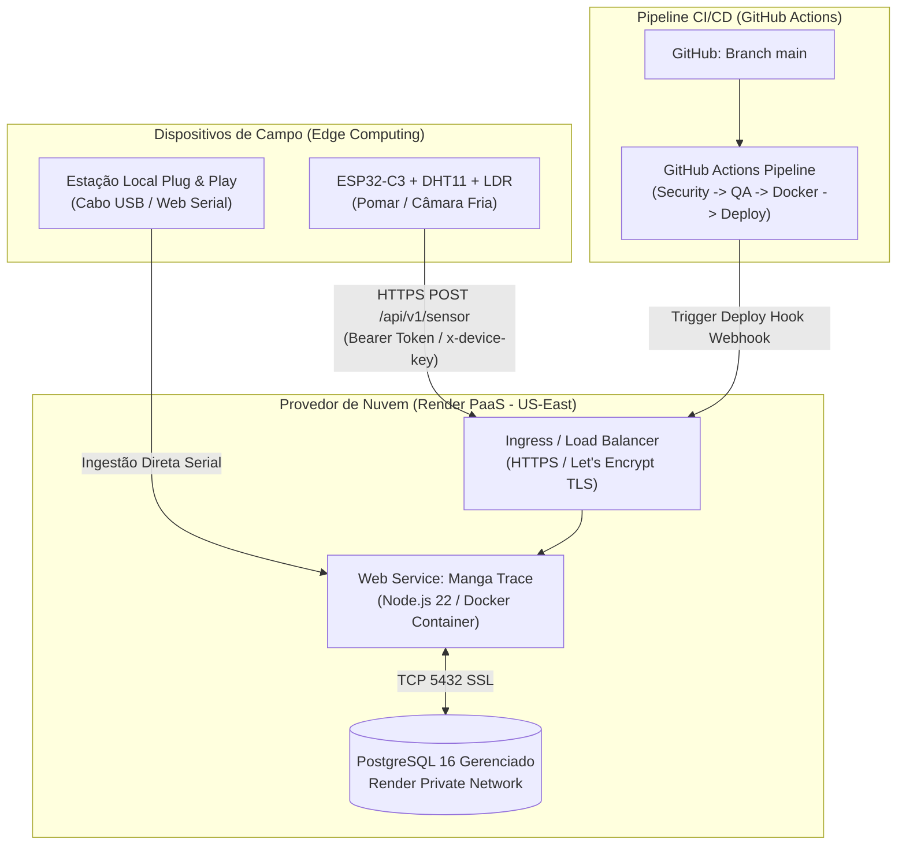

# ESP32 Microclimate Monitoring

This project reads temperature and humidity from one DHT11 sensor connected to an ESP32-C3. The firmware samples every five seconds, reports valid readings over Serial, serves a local status page, and sends authenticated readings to a Node.js API and PostgreSQL database. The Render service is deployed at `https://monitoramento-iot-api.onrender.com`; the device Serial Monitor showed two HTTP 201 responses from the public API after Wi-Fi connected. A previous public health check reported a connected database. Refresh the dashboard during the demonstration to confirm the latest reading is visible.

## Team

Homero, Joelson, Lucas Ximenes, Nicollas, Thayanne, João César, and Morgana.

Preview responsibilities are recorded in [`PLANO_ACAO.md`](PLANO_ACAO.md).

Preview PDFs: [technical delivery](entregas/Relatorio_Previa_IoT.pdf) and [presentation](entregas/Apresentacao_Previa_IoT.pdf).

## Hardware

- ESP32-C3 development board
- One DHT11 temperature and humidity sensor
- Breadboard and jumper wires
- Reused enclosure

Connect DHT11 VCC to 3V3, DATA to GPIO 5, and GND to ESP32 GND. Check the sensor board labels and board pinout before powering it. A bare sensor may need a pull-up resistor between DATA and 3V3; some modules include one.

See the [electrical connection diagram](docs/diagrama_eletrico.svg) and [component list](docs/lista_componentes.md).

## Firmware setup

1. Install Arduino IDE, the ESP32 board package, Adafruit DHT sensor library, and Adafruit Unified Sensor library.
2. Copy `credentials.example.h` to `credentials.h` beside `monitoramento.ino` and enter the local 2.4 GHz Wi-Fi network name and password. `credentials.h` is ignored by Git.
3. Open `monitoramento.ino` in Arduino IDE and select **ESP32C3 Dev Module** and the port shown for the connected board.
4. Compile and upload. Open Serial Monitor at 115200 baud.
5. Use the IP printed after Wi-Fi connects to open the local status page on the same Wi-Fi network.

The firmware logs Wi-Fi start, association, IP assignment, and disconnect reason. It retries failed connections with increasing waits up to 30 seconds, without changing Wi-Fi configuration during an active attempt. It periodically samples the DHT11 and distinguishes a failed current read from the most recent valid value. The team confirmed that the local browser page displays and refreshes temperature and humidity. The board later connected at `192.168.1.8` and its Serial Monitor showed two HTTP 201 responses from the public API. F1 Wi-Fi loss/recovery and F3 DHT11 failure/recovery passed functionally; outage duration and recovery latency were not timed.

## API and dashboard

The local API uses Node.js 22 and PostgreSQL. Copy `.env.example` to `.env`, replace every example secret, then run `docker compose up --build`. The API listens on port 3000; `/health` checks the service and database. The dashboard is a React PWA served at `http://<API_BIND_ADDRESS>:3000/` (use `localhost` when the bind address is `127.0.0.1`). Use **Criar conta** for a new viewer account or sign in with the local bootstrap account. New users choose a username and a password of at least 12 characters, then enroll their own authenticator by scanning the QR code. Microsoft Authenticator supports adding this as **Outra conta**; it generates local six-digit TOTP codes without push, email or SMS. Each new account receives read-only access to the configured demo device. Save the one-time recovery codes. For interface work without rebuilding the API image, run `npm run dev` inside `frontend/` while the API is on port 3000. To refresh the files the API serves, run `npm run build` in `frontend/`. This browser app is separate from the ESP32 status page at `http://<ESP32_IP>/`. It can be installed from the browser and shows the latest device contact time.

## Computação em Nuvem e DevOps (Entrega 2ª Unidade)

Esta seção documenta a arquitetura em nuvem, esteira CI/CD, modelo de dados, segurança, monitoramento e estimativa de custos do sistema **Manga Trace**, atendendo aos requisitos da 2ª unidade de Projeto Integrador (Prof. Ronierison Maciel).

### 1. URL do Sistema Publicado
- **Dashboard SPA & API (HTTPS):** [`https://monitoramento-iot-api.onrender.com`](https://monitoramento-iot-api.onrender.com)
- **Endpoint Público de Verificação de Saúde:** [`https://monitoramento-iot-api.onrender.com/health`](https://monitoramento-iot-api.onrender.com/health)

### 2. Provedor e Serviços Usados (Modelos SPI)
- **Provedor Principal:** Render (infraestrutura pública hospedada na AWS região `us-east-1` / Virgínia).
- **Frontend SPA (Manga Trace Dashboard):** **PaaS** (Render Web Service) — entrega estática integrada no Node.js com TLS 1.3 automático (Let's Encrypt).
- **Backend API (Node.js 22 LTS / Docker):** **PaaS** (Render Web Service) — ingestão de telemetria, autenticação JWT e cálculo da Regra dos 70% nas duas etapas (Pomar e Câmara Fria).
- **Banco de Dados (PostgreSQL 16):** **PaaS** (Render Managed PostgreSQL) — banco relacional com rede isolada privada, alta disponibilidade e rotinas diárias de backup.
- **Integração de Telemetria (ThingSpeak):** **SaaS** (MathWorks ThingSpeak) — redundância de séries temporais e visualização pública.
- **Pipeline CI/CD (GitHub Actions):** **SaaS** — esteira automatizada de segurança, testes, build Docker e deploy contínuo.

### 3. Diagrama da Arquitetura na Nuvem

### 4. Pipeline CI/CD e Histórico de Execuções
O pipeline está definido em [`.github/workflows/ci.yaml`](.github/workflows/ci.yaml) e engloba 4 jobs:
1. **`security`:** Gitleaks (detecção de segredos expostos), Semgrep (SAST de código Node.js) e Trivy (varredura de CVEs no sistema de arquivos).
2. **`qa`:** Execução automatizada de testes com `npm test` em Node.js 22 (testes unitários e de integração de rotas e cálculo do Selo de Qualidade).
3. **`docker-image`:** Build da imagem Docker (`manga-trace-api:latest`), varredura de vulnerabilidades da imagem com Trivy, auditoria estrita de usuário non-root (`USER node`) e teste de fumaça (Smoke Test) subindo o container e validando `/health` com HTTP 200.
4. **`deploy`:** Disparado exclusivamente em pushes na branch `main`, invocando o Deploy Hook do Render via webhook seguro e validando a URL pública.
- **Histórico das Execuções:** Acesse a aba **[Actions](https://github.com/JoelsonJose/Monitoramento-de-Temperatura-e-Umidade/actions)** no repositório GitHub para auditar todas as execuções do pipeline.

### 5. Como Refazer o Deploy do Zero
1. Conecte sua conta no [Render](https://render.com).
2. Clique em **New +** e selecione **Blueprint**.
3. Aponte para o repositório `JoelsonJose/Monitoramento-de-Temperatura-e-Umidade`.
4. O Render lerá automaticamente o arquivo [`render.yaml`](render.yaml) na raiz, provisionando simultaneamente o Web Service e o banco PostgreSQL.
5. Preencha as variáveis de ambiente sensíveis no painel: `DEVICE_API_KEY`, `DEMO_USER`, `DEMO_PASSWORD`, `THINGSPEAK_WRITE_API_KEY`.
6. No GitHub, adicione o secret `RENDER_DEPLOY_HOOK_URL` nas configurações do repositório (**Settings > Secrets and variables > Actions**) com a URL do Deploy Hook gerada no painel do Web Service do Render.

### 6. Variáveis de Ambiente Necessárias (Sem Valores Reais)
Consulte o arquivo [`.env.example`](.env.example) para o template de desenvolvimento. Em produção (Render):
- `NODE_ENV=production`
- `PORT=3000`
- `DATABASE_URL` (injetada automaticamente pelo Render via Blueprint vinculando ao banco gerenciado)
- `JWT_SECRET` (gerada automaticamente com entropia criptográfica pelo Render)
- `DEVICE_API_KEY` (chave secreta para autenticação da ESP32 via header `x-device-key`)
- `DEMO_USER` (nome de usuário inicial do dashboard)
- `DEMO_PASSWORD` (senha do usuário inicial do dashboard)
- `DEMO_DEVICE_ID=esp32c3-01`
- `THINGSPEAK_WRITE_API_KEY` (opcional: chave de escrita do canal do ThingSpeak)

### 7. Como Acessar os Logs e Verificação de Saúde
- **Verificação Ativa de Saúde:** Acesse [`https://monitoramento-iot-api.onrender.com/health`](https://monitoramento-iot-api.onrender.com/health). Retorna HTTP 200 com `{"status":"ok","database":"connected"}` validando tanto a API quanto a conexão ativa com o PostgreSQL.
- **Logs em Produção:** No painel do Render, selecione o serviço **monitoramento-iot-api** e acesse a aba **Logs**. O stream em tempo real exibe requisições HTTP, conexões de dispositivos e eventos de auditoria.

### 8. Estimativa de Custos nos Dois Cenários
- **Cenário 1 (Uso Atual — Projeto Piloto / Acadêmico):**
  - Web Service Free (0.1 vCPU, 512 MB RAM) + PostgreSQL Free DB (1 GB disco) + SSL Let's Encrypt.
  - **Custo Mensal: $0.00 (Gratuito)** *(ou ~$14.00/mês para planos Starter sem cold start)*.
- **Cenário 2 (10x Mais Usuários — Escala Comercial com Múltiplas Fazendas):**
  - 2 instâncias Web Service Standard (1 vCPU, 2 GB RAM cada para alta disponibilidade) + PostgreSQL Starter gerenciado (1 vCPU, 2 GB RAM, 30 GB SSD com backups contínuos) + retenção de logs de 30 dias.
  - **Custo Mensal: ~$85.00/mês (~R$ 490,00/mês)**.

---

## Render deployment

The root `render.yaml` defines a Node web service, managed PostgreSQL, HTTPS health check, and secret environment variables. The service is deployed at [`https://monitoramento-iot-api.onrender.com`](https://monitoramento-iot-api.onrender.com). A public `/health` check returned `{"status":"ok","database":"connected"}` before the device upload. After the board was configured, its Serial Monitor showed two HTTP 201 responses from the public API. The dashboard is served at the same address; use the configured demo credentials and refresh it to confirm the newest cloud reading. Keep secrets in Render and in the ignored local `credentials.h`; never commit or share their values. The free database is suitable only for a short preview; preserve any evidence needed for the presentation.

For local setup, copy [`credentials.example.h`](credentials.example.h) to a local, ignored `credentials.h`, enter the Wi-Fi and API settings there, and upload the sketch to the ESP32. The public service and board upload have been exercised: the board reported HTTP 201 responses. During the demonstration, sign in at the dashboard and check that the latest reading and last-contact time appear. Do not paste secret values into GitHub or shared documents.

To enable ThingSpeak, create a channel with field 1 for temperature (°C) and field 2 for humidity (%), then set the channel Write API Key in the ignored local `.env` as `THINGSPEAK_WRITE_API_KEY`. The API forwards physical readings over HTTPS at most once per 16 seconds and logs the HTTP result and entry ID without logging the key. Leave it blank to disable forwarding. Two live writes returned HTTP 200 with entry IDs 1 and 2, 20 seconds apart on 16/11/2026. After a later local API restart, new attempts returned HTTP 400 and need re-verification. The free ThingSpeak rate is 15 seconds per channel.

During the local integration check, both Compose services were healthy; the local dashboard/login worked, protected routes returned HTTP 401 without a token and HTTP 403 for a user without device access, and physical DHT11 readings were confirmed in PostgreSQL. On 16/11/2026, a public Render health check reported the managed database connected. After the ESP32 was configured, its Serial Monitor displayed two HTTP 201 responses from the public API. Five route/unit tests passed locally, and the latest recorded GitHub Actions runs passed. Refresh the authenticated dashboard during the presentation to verify that it displays the newest cloud reading. ThingSpeak forwarding needs review after recent HTTP 400 responses.

The API is exposed through Render's HTTPS ingress; PostgreSQL is managed privately by Render and is not exposed as a public service. Firmware supports HTTPS when configured with a trusted PEM certificate as `API_ROOT_CA`. The device has returned HTTP 201 from the public endpoint. Do not commit credentials.

API details: [`docs/api.md`](docs/api.md). Architecture: [`docs/architecture.md`](docs/architecture.md).
Test plan and observed F1/F3 results: [`docs/plano_testes.md`](docs/plano_testes.md).

## Repository guide

- `monitoramento.ino` — ESP32-C3 firmware
- `frontend/` — React PWA (Vite, Radix UI, service worker)
- `backend/` — REST API that serves the built PWA
- `database/init.sql` — PostgreSQL schema
- `docs/` — architecture, API, and security notes
- `docs/diagrama_eletrico.svg` — ESP32-C3 and DHT11 wiring
- `docs/diagrama_er.md` — database entities and relationships
- `render.yaml` — Render web service and PostgreSQL Blueprint
- `docs/lista_componentes.md` — bill of materials and known quantities
- `docs/plano_testes.md` — preview test cases and evidence
- `docs/ia/baseline_previa.md` — preview forecasting problem and measured persistence baseline
- `docs/ux/pesquisa_previa.md` — documentary research, provisional mango-use personas, and interview guide; primary user responses still need to be collected
- `docs/pitch/opening_english.md` — two-minute English opening script assigned to Nicollas
- `docs/pitch/guia_apresentacao_pt.md` — Portuguese speaking notes for the mixed-language deck requested by the team
- `REQUISITOS_UC.md` — evidence matrix for the eight course units
- `RESILIENCIA.md` — resilience requirements and test record
- `PLANO_ACAO.md` — open work, owners, and evidence to collect

## Current limitations

The preview hardware uses the team's selected single DHT11 sensor. The sensor and reused enclosure are not calibrated or certified for industrial cold rooms. The public API accepted device requests (HTTP 201); refresh the dashboard to check the current value. The mobile app, final AI model, primary user study, duplicate/replay testing, and advanced security controls remain separate work. ThingSpeak returned HTTP 200 with entry IDs 1 and 2 in earlier tests; later attempts returned HTTP 400 and need re-verification. See the action plan and evidence matrix for current statuses.
