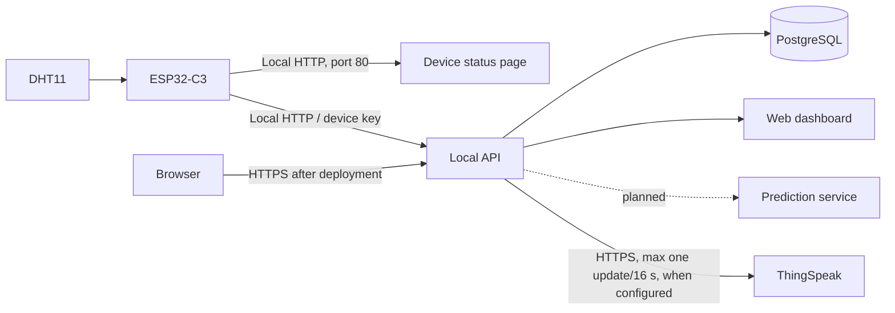

# System architecture

The demonstrated path runs from the DHT11 through the ESP32-C3 to the local API and PostgreSQL, then forwards physical temperature/humidity readings to ThingSpeak. Two HTTPS writes returned HTTP 200 with entry IDs 1 and 2, 20 seconds apart. The local ESP32-to-API hop still uses HTTP on the private LAN; public API HTTPS remains pending.

The preview prototype uses one DHT11. Its wiring is documented in [`diagrama_eletrico.svg`](diagrama_eletrico.svg), the component inventory is in [`lista_componentes.md`](lista_componentes.md), and the observable test cases/results are in [`plano_testes.md`](plano_testes.md). F1 Wi-Fi recovery and F3 sensor failure/recovery passed functionally; precise outage and recovery durations were not timed.

| Component | Protocol / port | Current state |
|---|---|---|
| ESP32-C3 local page | HTTP / TCP 80 | Implemented; local page, F1 reconnection and F3 handling/recovery observed on hardware |
| API | HTTP / TCP 3000 on the host's private LAN IP | Live ESP32 ingestion tested; public deployment pending |
| PostgreSQL | TCP 5432, private compose network | Live ESP32 readings persisted; backup/restore pending |
| Public edge / TLS | HTTPS / TCP 443 | Pending hosting and domain |
| Mobile application | HTTPS | Not implemented |
