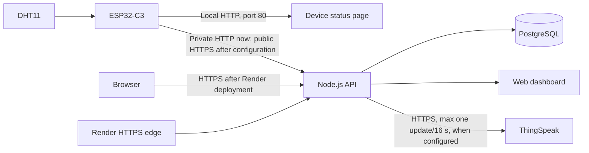

# System architecture

The demonstrated path runs from the DHT11 through the ESP32-C3 to the local API and PostgreSQL, then forwards physical temperature/humidity readings to ThingSpeak. Two earlier HTTPS writes returned HTTP 200 with entry IDs 1 and 2, 20 seconds apart; newer attempts after a local API restart returned HTTP 400 and need re-verification. The local ESP32-to-API hop still uses HTTP on the private LAN. A Render Blueprint is prepared; public deployment and HTTPS ingestion by the physical board remain pending until the service URL is created and verified.

The preview prototype uses one DHT11. Its wiring is documented in [`diagrama_eletrico.svg`](diagrama_eletrico.svg), the component inventory is in [`lista_componentes.md`](lista_componentes.md), data relationships are in [`diagrama_er.md`](diagrama_er.md), and test cases/results are in [`plano_testes.md`](plano_testes.md). The team confirmed F1 Wi-Fi recovery and F3 sensor failure/recovery functionally; their durations were not instrumented.

The API startup migration creates `devices`, `users`, `device_access`, and `readings`, backfills existing device IDs, seeds the configured demo user/device, and updates `devices.last_seen_at` as readings arrive. The dashboard shows the last device contact. Database constraints and the ER diagram are part of the preview implementation.

| Component | Protocol / port | Current state |
|---|---|---|
| ESP32-C3 local page | HTTP / TCP 80 | Implemented; local page, F1 reconnection and F3 handling/recovery observed on hardware |
| API | HTTP / TCP 3000 locally; HTTPS / TCP 443 after Render deploy | Live ESP32 ingestion tested locally; Render deploy pending |
| PostgreSQL | TCP 5432, private compose network | Live ESP32 readings persisted; backup/restore pending |
| Public edge / TLS | Render-managed HTTPS / TCP 443 | Blueprint prepared; deployed URL and ESP32 upload not yet verified |
| Mobile application | HTTPS | Not implemented |
