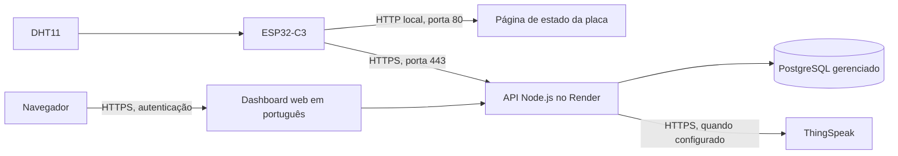

# Arquitetura do sistema

O protótipo usa um único sensor DHT11 para medir temperatura e umidade. A placa lê o sensor, mantém uma página local de estado e envia leituras autenticadas à API pública. O Serial Monitor mostrou duas respostas HTTP 201 do endpoint público depois da configuração da placa. Uma consulta anterior a `/health` informou que o banco estava conectado. A conferência da leitura no dashboard público deve ser feita ao vivo durante a demonstração.

O dashboard exige autenticação e consulta a leitura mais recente e o horário do último contato do dispositivo. A interface foi traduzida para português. A API pública está em `https://monitoramento-iot-api.onrender.com`.

| Componente | Protocolo / porta | Estado |
|---|---|---|
| Página local da ESP32-C3 | HTTP / TCP 80 | Implementada; leitura do DHT11 e recuperação F1/F3 observadas na placa |
| API Node.js | HTTPS / TCP 443 público; porta 3000 local | Implantada no Render; duas respostas HTTP 201 registradas pela placa |
| PostgreSQL | TCP 5432, rede privada do serviço | Serviço gerenciado; `/health` informou conexão ativa |
| Acesso ao dashboard | HTTPS / TCP 443 | Interface web com login; idioma português; atualizar e confirmar dados na apresentação |
| ThingSpeak | HTTPS / TCP 443 | Duas gravações anteriores HTTP 200; tentativas recentes HTTP 400 requerem revisão |
| Aplicativo móvel | HTTPS | Não implementado nesta prévia |

A ligação elétrica está em [`diagrama_eletrico.svg`](diagrama_eletrico.svg), a lista de componentes em [`lista_componentes.md`](lista_componentes.md), as relações de dados em [`diagrama_er.md`](diagrama_er.md) e os casos de teste em [`plano_testes.md`](plano_testes.md). A equipe confirmou funcionalmente F1 (recuperação do Wi-Fi) e F3 (falha e recuperação do sensor); os tempos não foram medidos.

A migração da API cria as tabelas `devices`, `users`, `device_access` e `readings`, atualiza `devices.last_seen_at` quando chegam leituras válidas e usa a combinação dispositivo/sequência para evitar duplicações.
