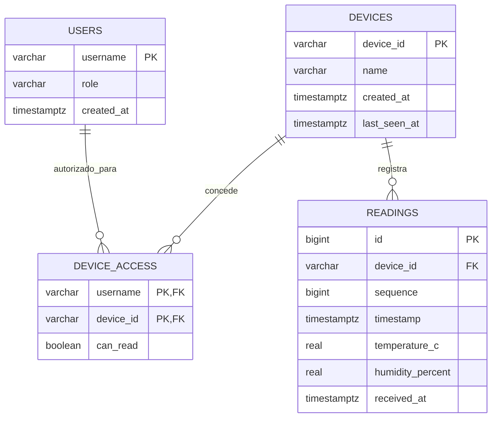

# Database ER diagram

A migração da API cria essas tabelas na inicialização, adiciona linhas de dispositivos existentes, prepara o usuário e dispositivo de demonstração configurados e atualiza `devices.last_seen_at` quando chega tráfego válido. A tabela `readings` tem uma restrição única em `(device_id, sequence)` para evitar duplicar envios com a mesma sequência.
