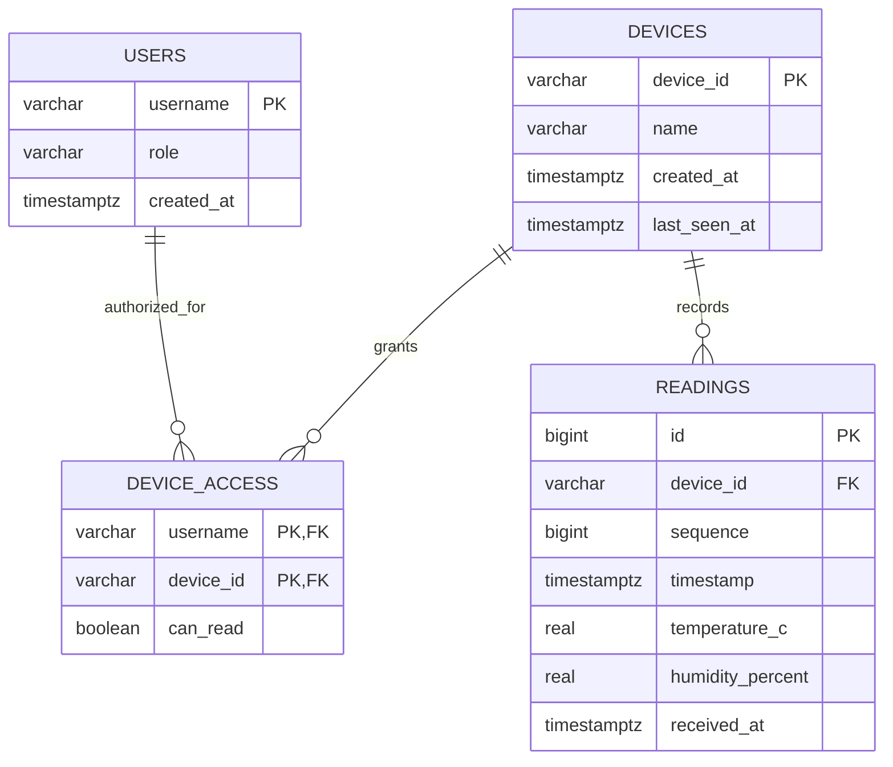

# Database ER diagram

The API migration creates these tables on startup, backfills device rows for existing measurements, seeds the configured demo user and device, and updates `devices.last_seen_at` whenever valid device traffic arrives. `readings` has a unique constraint on `(device_id, sequence)` to make duplicate submissions idempotent.
