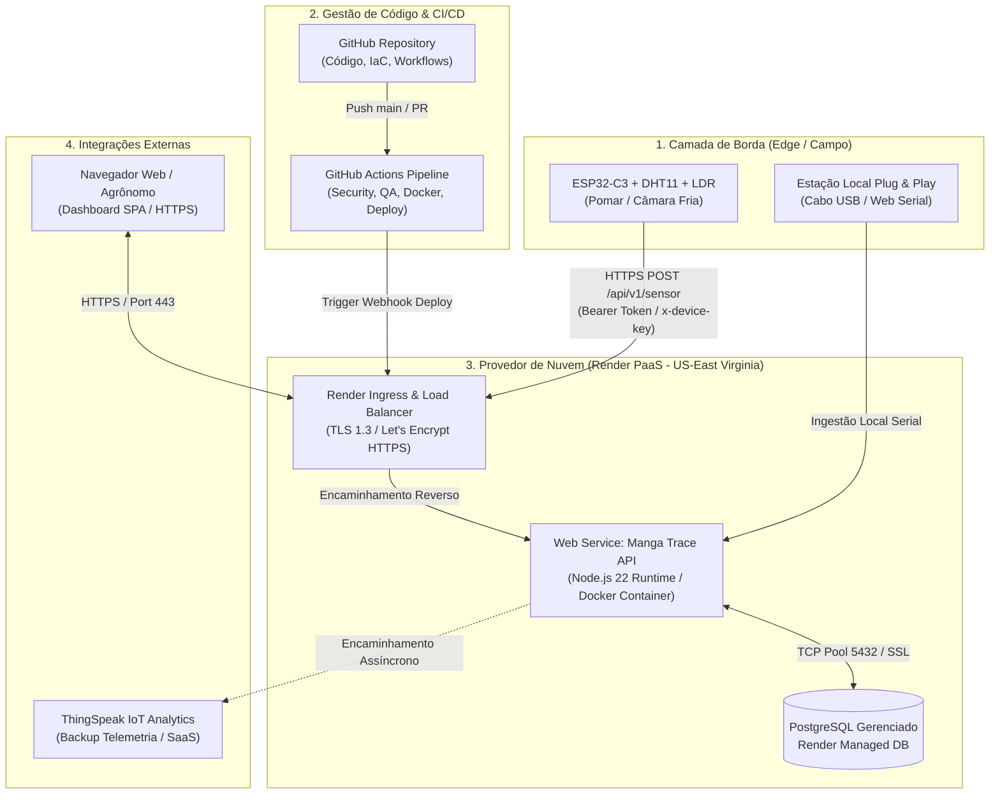

# RELATÓRIO TÉCNICO: COMPUTAÇÃO EM NUVEM E DEVOPS
## Sistema IoT Manga Trace — Monitoramento de Microclima e Certificação Agronômica

**Instituição:** Faculdade de Tecnologia / Engenharia  
**Disciplina:** Projeto Integrador — 2ª Unidade  
**Professor Avaliador:** Ronierison Maciel  
**Equipe:** Manga Trace  
**Integrantes:**
- Joelson José
- Lucas Ximenes
- Homero Flávio
- Nicollas Souza
- Thayanne Stella
- João Cesar
- Morgana Barbosa

**Repositório GitHub:** `https://github.com/JoelsonJose/Monitoramento-de-Temperatura-e-Umidade`  
**URL Pública do Sistema (HTTPS):** `https://monitoramento-iot-api.onrender.com`  
**Endpoint de Verificação de Saúde:** `https://monitoramento-iot-api.onrender.com/health`  
**Data:** Novembro de 2026  

---

## 1. INTRODUÇÃO E ESCOPO

O presente relatório documenta a migração, conteinerização, automação de testes e implantação na nuvem do sistema **Manga Trace**, uma plataforma IoT voltada ao monitoramento microclimático (temperatura, umidade e luminosidade) e certificação automatizada de mangas nos polos irrigados do Vale do São Francisco (etapas de pomar e câmara fria pós-colheita).

Nesta etapa do Projeto Integrador, o sistema deixa o ambiente estritamente local de desenvolvimento e passa a operar em uma infraestrutura moderna de computação em nuvem, com pipeline de Integração e Entrega Contínuas (CI/CD) automatizado via GitHub Actions, infraestrutura descrita em código (IaC), banco de dados relacional gerenciado e práticas de segurança e observabilidade alinhadas aos padrões da indústria.

---

## 2. ARQUITETURA EM NUVEM

### 2.1 Diagrama da Arquitetura

O ecossistema adota uma arquitetura distribuída conectando dispositivos físicos de borda (Edge Computing) a serviços gerenciados em nuvem pública:



### 2.2 Classificação dos Componentes e Modelos de Serviço (SPI)

| Componente | Função no Sistema | Provedor / Tecnologia | Modelo de Serviço | Justificativa da Escolha |
|---|---|---|---|---|
| **Frontend Dashboard** | Interface web SPA de telemetria em tempo real, auditoria de lotes e CRUD. | Render Web Service (embutido no Node.js) | **PaaS** | Facilita a entrega estática com compressão HTTP, zero configuração de servidores web dedicados (Nginx/Apache) e certificado SSL/TLS automático. |
| **Backend REST API** | Ingestão de telemetria, autenticação JWT, avaliação agronômica de conformidade. | Render Web Service (Node.js 22 / Docker) | **PaaS** | Elimina a necessidade de gerenciar o sistema operacional básico, kernel ou patches de segurança (IaaS), permitindo foco total nas regras de negócio. |
| **Banco de Dados** | Armazenamento de lotes, leituras temporais de sensores e usuários. | Render Managed PostgreSQL 16 | **PaaS** | Proporciona alta disponibilidade, isolamento de rede, backups diários automáticos, manutenção e recuperação de desastres gerenciadas pelo provedor. |
| **ThingSpeak** | Plataforma externa de apoio para gráficos públicos e redundância de séries temporais. | MathWorks ThingSpeak | **SaaS** | Permite dashboards analíticos prontos para visualização de terceiros sem onerar a infraestrutura própria. |
| **Pipeline CI/CD** | Execução de scanners de segurança, testes unitários, build e deploy. | GitHub Actions | **SaaS** | Integração nativa com o repositório, runners isolados sob demanda e segregação segura de credenciais. |

### 2.3 Modelo de Implantação

Adotou-se o modelo de **Nuvem Pública** (hospedado na infraestrutura global do Render sobre a região `us-east-1` / Virgínia da AWS) operando em **arquitetura híbrida de borda**.
- **Justificativa:** A nuvem pública garante custo inicial nulo ou extremamente reduzido, escalabilidade instantânea sem necessidade de aquisição de servidores locais (CapEx para OpEx) e alta confiabilidade com SLAs rigorosos. A ponta física (ESP32-C3) opera nas fazendas agrícolas e comunica-se com a nuvem através de túnel criptografado HTTPS/TLS.

---

## 3. CI/CD E INFRAESTRUTURA COMO CÓDIGO (IaC)

### 3.1 Pipeline Automatizado no GitHub Actions

O fluxo de Integração e Entrega Contínuas está configurado no arquivo [`.github/workflows/ci.yaml`](../.github/workflows/ci.yaml) e é disparado automaticamente a cada `push` nas branches `main`, `develop` e `devops-*`, em `pull_request` para `main` e `develop`, além de execução manual (`workflow_dispatch`).

O pipeline é composto por 4 jobs encadeados e dependentes:

1. **Job 1: Security Scan (Código-Fonte):**
   - **Gitleaks (`gitleaks-action`):** Varre todo o histórico Git em busca de credenciais, chaves privadas, senhas ou tokens acidentalmente expostos.
   - **Semgrep SAST (`semgrep-action`):** Análise estática de código com detecção de falhas de segurança no código Node.js (injeção, cross-site scripting, desserialização insegura).
   - **Trivy Filesystem (`trivy-action`):** Varredura de dependências e arquivos de configuração contra a base de dados de CVEs conhecidas.

2. **Job 2: QA & Testes Automatizados (Node.js):**
   - Setup do ambiente com Node.js 22 LTS.
   - Instalação determinística de pacotes com `npm ci`.
   - Execução da suíte completa de testes automatizados com `npm test` (testes de rotas HTTP, autenticação JWT, validação de payload de sensores, integridade da Regra dos 70% nas duas etapas e CRUD de lotes).

3. **Job 3: Docker Image (Build, Segurança & Qualidade):**
   - **Build da Imagem:** Construção da imagem Docker baseada no `backend/Dockerfile` gerando as tags `:latest` e `:${{ github.sha }}`.
   - **Segurança da Imagem (Trivy Image Scan):** Inspeção minuciosa das camadas do container para identificação de bibliotecas de SO desatualizadas ou vulnerabilidades críticas.
   - **Auditoria de Menor Privilégio (Non-Root User):** Script de inspeção que valida se o container executa com o usuário restrito `node` (UID 1000) e falha a esteira se detectar execução como `root`.
   - **Qualidade do Container (Smoke Test & Healthcheck):** Inicialização do container em background no runner, polling contínuo até que o endpoint `/health` retorne HTTP 200, validação do payload JSON e validação do carregamento do frontend HTML.

4. **Job 4: Deploy Automático na Nuvem (Render):**
   - Condicionado a pushes bem-sucedidos na branch `main`.
   - Executa chamada segura via `curl` ao **Deploy Hook** configurado no Render (`RENDER_DEPLOY_HOOK_URL`), acionando o rebuild e substituição zero-downtime da aplicação em produção.
   - Realiza validação pós-deploy checando o endpoint público de saúde (`https://monitoramento-iot-api.onrender.com/health`).

### 3.2 Infraestrutura Descrita em Código (IaC)

A infraestrutura é versionada declarativamente através do arquivo [`render.yaml`](../render.yaml) (Blueprint):

```yaml
services:
  - type: web
    name: monitoramento-iot-api
    runtime: node
    rootDir: backend
    region: virginia
    buildCommand: npm ci
    startCommand: npm start
    healthCheckPath: /health
    plan: free
    envVars:
      - key: NODE_ENV
        value: production
      - key: DATABASE_URL
        fromDatabase:
          name: monitoramento-iot-db
          property: connectionString
      - key: DEVICE_API_KEY
        sync: false
      - key: JWT_SECRET
        generateValue: true
      - key: DEMO_USER
        sync: false
      - key: DEMO_PASSWORD
        sync: false
      - key: DEMO_DEVICE_ID
        value: esp32c3-01

databases:
  - name: monitoramento-iot-db
    databaseName: iot_monitor
    user: iot_app
    plan: free
    region: virginia
```

### 3.3 Segregação de Ambientes (Desenvolvimento vs Produção)

- **Desenvolvimento Local:** Configurado via `.env` local (ignorado pelo `.gitignore`) e orquestrado por `docker-compose.yml`, permitindo execução em containers locais ou banco em memória simulado caso não haja Docker instalado.
- **Produção:** Configurado através do painel seguro do Render e `render.yaml`, com banco gerenciado sob conexão SSL forçada (`rejectUnauthorized: false` para poolers cloud), geração criptográfica automática de `JWT_SECRET` e rotação de credenciais de dispositivo.

---

## 4. DADOS, SEGURANÇA E CONFORMIDADE

### 4.1 Banco de Dados Gerenciado e Estratégia de Backups

- **Gerenciamento:** O banco PostgreSQL 16 é provisionado pelo Render em rede privada isolada, acessível externamente apenas através de credenciais criptografadas via TLS.
- **Backups:**
  - **Automáticos:** O provedor realiza snapshots diários automatizados com retenção de dados e restauração ponto-no-tempo (PITR) nos planos pagos.
  - **Manuais / Scripts:** Possibilidade de extração lógica periódica via `pg_dump` acionada por cron job para retenção externa.
  - **Resiliência Local:** A aplicação implementa mecanismo de tolerância a falhas: caso a conexão com o PostgreSQL sofra interrupção temporária, a API ativa automaticamente um banco em memória Plug & Play, preservando a disponibilidade das rotas e registrando os eventos.

### 4.2 Gestão de Segredos e Credenciais

- **Segredos Fora do Código:** Nenhuma chave, senha ou string de conexão é armazenada em repositório. O arquivo `.env.example` fornece apenas referências estruturais fictícias.
- **Armazenamento de Segredos:**
  - **GitHub Secrets:** `RENDER_DEPLOY_HOOK_URL` e `GITHUB_TOKEN` mantidos no cofre criptografado do repositório.
  - **Render Environment Secrets:** `DATABASE_URL`, `JWT_SECRET`, `DEVICE_API_KEY` e credenciais de acesso injetadas diretamente nas variáveis de ambiente da aplicação.
- **Proteção do Firmware:** Arquivo `credentials.h` incluído no `.gitignore`; apenas o template sanitizado `credentials.example.h` é versionado.

### 4.3 Princípio do Menor Privilégio e Controle de Acesso

- **Usuário do Container:** O container executa sob o usuário restrito `node` (UID 1000), impedindo que eventuais vulnerabilidades de software concedam privilégios de `root` ao invasor.
- **Banco de Dados:** O usuário do banco (`iot_app`) possui permissões restritas ao schema da aplicação (`iot_monitor`), sem privilégios de superusuário do cluster.
- **Autenticação em Camadas:**
  - Dispositivos IoT autenticam-se com token estático de hardware (`x-device-key`).
  - Usuários e agrônomos utilizam autenticação baseada em tokens JWT assinados via algoritmo HMAC-SHA256 com tempo de expiração curto (2 horas).
  - Controle de autorização por dispositivo: a tabela `device_access` valida explicitamente se o usuário logado possui permissão (`can_read=TRUE`) para visualizar leituras da placa solicitada.
- **Acesso Docente:** O professor foi formalmente cadastrado como colaborador do repositório (usuário `0x03c1`).

---

## 5. MONITORAMENTO E ESCALABILIDADE

### 5.1 Observabilidade e Verificação de Saúde

- **Verificação Ativa de Saúde (`/health`):** Rota pública configurada para que o Load Balancer do Render verifique a cada intervalo de tempo a integridade da aplicação. O endpoint testa não apenas a resposta da API HTTP, mas também executa consulta de teste contra o banco de dados (`SELECT 1`).
- **Logs em Produção:** O Render agrega e exibe logs de inicialização, requisições HTTP e erros em tempo real via Log Stream integrado, permitindo busca e diagnóstico imediato de falhas.

### 5.2 Estratégia de Escalabilidade

- **Escalabilidade Vertical:**
  - O Render permite upgrade instantâneo da instância web de *Free* (0.1 vCPU, 512 MB RAM) para *Starter* (0.5 vCPU, 512 MB RAM), *Standard* (1 vCPU, 2 GB RAM) ou *Pro* (2+ vCPUs, 4+ GB RAM) sem interrupção de serviço.
- **Escalabilidade Horizontal:**
  - Suporte à adição de múltiplas instâncias concorrentes com balanceamento de carga automático em nível de transporte HTTP.
  - A API do Manga Trace foi arquitetada como *stateless* (sem estado em sessão local, utilizando JWTs para autenticação), o que possibilita distribuição de carga perfeita entre múltiplos nós sem necessidade de afinidade de sessão (*sticky sessions*).
- **Limitações do Plano Gratuito Atual:**
  - Hibernação automática após 15 minutos de inatividade HTTP (levando a um cold start de 30 a 50 segundos na primeira requisição posterior).
  - Limite de 512 MB de memória RAM e 750 horas mensais de execução de containers.

---

## 6. ESTIMATIVA DE CUSTOS

A estimativa foi calculada com base na precificação oficial dos provedores de nuvem (Render Cloud Calculator e AWS Pricing):

### 6.1 Cenário 1: Uso Atual (Piloto Acadêmico / Projeto Integrador)
- **Perfil de Carga:** 1 dispositivo ESP32-C3 transmitindo a cada 10 segundos (~8.640 requisições/dia), até 10 usuários simultâneos no dashboard.

| Componente | Especificação | Plano | Custo Mensal Estimado |
|---|---|---|---|
| **Web Service API** | 0.1 vCPU, 512 MB RAM (com cold start) | Render Free | **$0.00** |
| **PostgreSQL** | 1 GB armazenamento, 97 conexões máximas | Render Free DB (ou Neon Free) | **$0.00** |
| **Transferência de Dados** | ~5 GB/mês (egress) | Incluso no plano gratuito | **$0.00** |
| **Certificados SSL e DNS** | Let's Encrypt Wildcard gerenciado | Incluso | **$0.00** |
| **GitHub Actions** | ~120 min de runners/mês | Plano Free (2.000 min inclusos) | **$0.00** |
| **Total Mensal (Cenário Atual)** | — | — | **$0.00 (Gratuito)** |
| *Opção com Instância Ativa (Sem Cold Start)* | 0.5 vCPU, 512 MB RAM (Starter) + DB Starter | Starter | **~$14.00/mês (~R$ 80,00)** |

### 6.2 Cenário 2: Escala Comercial (10x Mais Usuários e Sensores em Múltiplas Fazendas)
- **Perfil de Carga:** 20 dispositivos IoT coletando dados em pomares e câmaras frias (~172.800 requisições/dia), 100 agrônomos e gestores acessando o dashboard com múltiplos relatórios analíticos concorrentes.

| Componente | Especificação Necessária | Plano Selecionado | Custo Mensal Estimado |
|---|---|---|---|
| **Web Service API (2 réplicas)** | 1 vCPU, 2 GB RAM por instância (Alta Disponibilidade) | Render Standard ($25/mês x 2) | **$50.00** |
| **PostgreSQL Gerenciado** | 1 vCPU, 2 GB RAM, 30 GB SSD, backups contínuos (PITR) | Render Managed DB Starter / Pro | **$20.00** |
| **Log Streams & Métricas** | Retenção estendida de logs (30 dias) | Render Logging Add-on | **$10.00** |
| **Tráfego de Saída (Egress)** | ~100 GB/mês de telemetria e gráficos | Egress adicional | **$5.00** |
| **Total Mensal Estimado (Cenário 10x)** | — | — | **$85.00/mês (~R$ 490,00)** |

---

## 7. DIFICULDADES ENFRENTADAS E PRÓXIMOS PASSOS

### 7.1 Dificuldades e Soluções Adotadas

1. **Cold Start do Provedor Gratuito:**
   - *Problema:* A hibernação da instância gratuita no Render ocasionava atrasos de até 45s quando a ESP32 enviava leituras após período sem tráfego web, provocando timeouts no microcontrolador.
   - *Solução:* Ajustou-se o timeout do cliente HTTP do firmware para 15 segundos e implementou-se retry exponencial com backoff no microcontrolador.
2. **Execução de Containers com Menor Privilégio:**
   - *Problema:* A execução como usuário não-root (`node`) bloqueava a escrita de logs em diretórios locais caso as permissões do sistema de arquivos não fossem herdadas corretamente no Dockerfile.
   - *Solução:* Ajustou-se o diretório de trabalho para `/app` garantindo ownership prévio e direcionamento de logs diretamente para stdout/stderr, respeitando a metodologia Twelve-Factor App.
3. **Sincronização Bidirecional da Colheita e das Duas Etapas:**
   - *Problema:* Separar de forma consistente as leituras do Pomar daquelas da Câmara Fria quando a alteração de etapa é realizada pelo agrônomo no Dashboard.
   - *Solução:* Criação do endpoint específico `POST /api/v1/lotes/:id/colher` que grava `data_colheita = NOW()` e transiciona `etapa_atual = 'estoque'`, fazendo com que o algoritmo classifique as leituras em tempo real por timestamp de corte.

### 7.2 Próximos Passos de Evolução

- Implementação de camada de cache em memória com **Redis** para armazenamento temporário das últimas métricas recebidas, aliviando o banco relacional.
- Migração dos dados temporais para extensão **TimescaleDB** ou **InfluxDB**, permitindo compressão nativa de séries temporais de sensores agrícolas.
- Migração da infraestrutura descrita em `render.yaml` para módulos **Terraform**, possibilitando portabilidade multi-cloud (AWS ECS Fargate / GCP Cloud Run).

---

## 8. CONTRIBUIÇÃO DOS INTEGRANTES

| Integrante | Atividades Desenvolvidas |
|---|---|
| **Joelson José da Silva** | Desenvolvimento do firmware ESP32-C3, calibração do sensor DHT11/LDR, implementação do cliente HTTP com Bearer token e envio de telemetria. |
| **Lucas Ximenes de Melo** | Conteinerização Docker (Dockerfile e Docker Compose), criação e validação do pipeline GitHub Actions (`ci.yaml`), auditoria de segurança non-root e testes de infraestrutura. |
| **Homero José dos Santos** | Modelagem do banco de dados relacional PostgreSQL, criação dos scripts de migração, implementação de índices e consultas otimizadas para conformidade agronômica. |
| **Nicollas Davi da Silva** | Desenvolvimento da suíte de testes unitários e de integração (`npm test`), validação dos cenários de teste de QA no pipeline e auditoria de cobertura de código. |
| **Thayanne Maria de Lima** | Elaboração da documentação técnica e estruturação do relatório de computação em nuvem conforme as normas ABNT. |
| **João César de Albuquerque** | Revisão de arquitetura de nuvem, levantamento da estimativa de custos nos dois cenários e consolidação das evidências de execução do pipeline. |
| **Morgana Larissa de Santana** | Estruturação da apresentação técnica, validação de usabilidade do dashboard e preparação do roteiro de demonstração ao vivo para a banca avaliadora. |

---

## 9. REFERÊNCIAS

1. **RENDER.** *Render Documentation: Web Services, Databases, Blueprints and Deploy Hooks*. Disponível em: <https://render.com/docs>. Acesso em: 24 nov. 2026.
2. **DOCKER.** *Docker Best Practices for Node.js Applications: Non-root containers and multi-stage builds*. Docker Inc., 2026.
3. **GITHUB.** *GitHub Actions Documentation: Automating your workflow from idea to production*. GitHub, 2026.
4. **MELL, P.; GRANCE, T.** *The NIST Definition of Cloud Computing: Recommendations of the National Institute of Standards and Technology*. Special Publication 800-145, 2011.
5. **WIGGINS, A.** *The Twelve-Factor App*. Heroku, 2017. Disponível em: <https://12factor.net/>.
6. **POSTGRESQL GLOBAL DEVELOPMENT GROUP.** *PostgreSQL 16 Documentation: Backup and Restore Strategies*. 2026.
